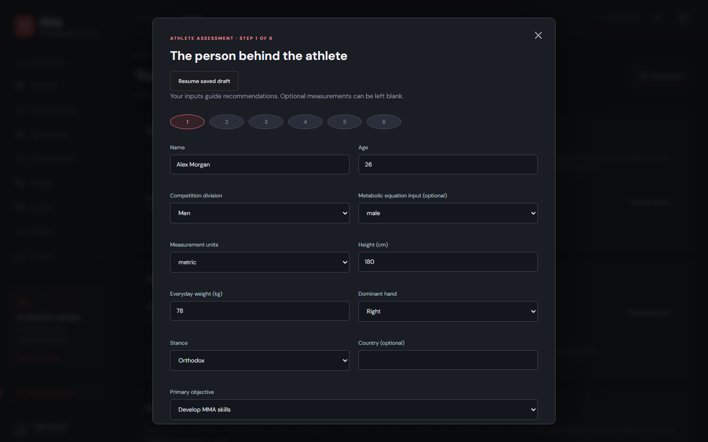
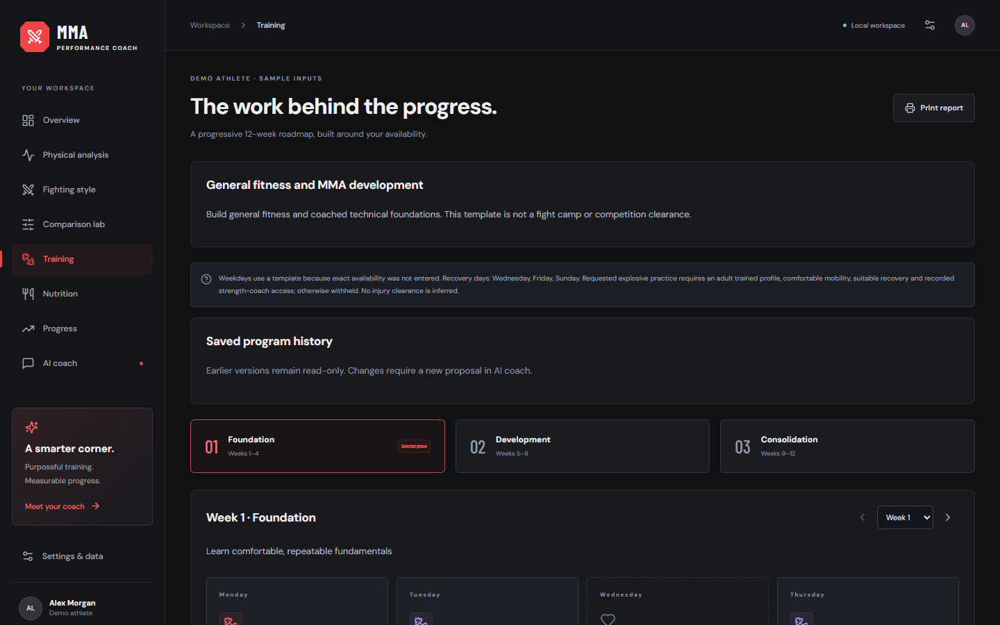
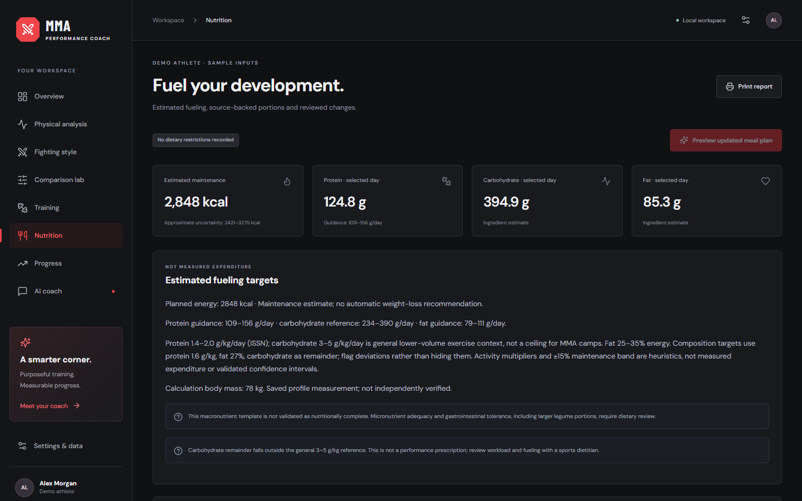
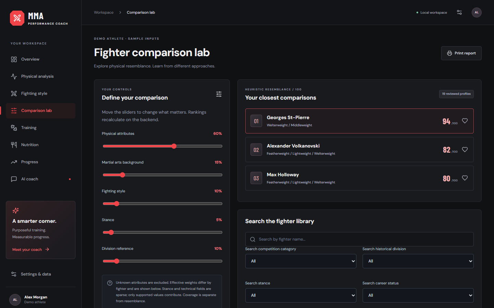

# MMA Performance Coach

[](https://github.com/MoDaraiseh/mma-performance-coach/actions/workflows/ci.yml)

A local training app for amateur mixed martial artists. You fill in a guided assessment, and the app builds a 12-week training plan and a seven-day meal plan from it. It tracks your workouts and check-ins and compares your measurements with a small, source-referenced set of UFC fighters. An optional AI coach explains the plan and proposes changes, and nothing is saved until you approve it.

**Stack:** React, TypeScript, Vite and Recharts on the frontend; FastAPI, Pydantic, SQLAlchemy and Alembic on the backend, with SQLite by default and PostgreSQL supported.

| Assessment wizard | Training plan |
| --- | --- |
|  |  |
| **Nutrition** | **Fighter comparison** |
|  |  |

Screenshots show the built-in demo athlete (synthetic data).

> **Status:** release candidate `1.0.0-rc.17`, for local use. It has not been publicly deployed, and its training and nutrition guidance has not been reviewed by qualified coaches, dietitians or medical professionals. It is not medical or nutritional advice. See [known limitations](docs/KNOWN_LIMITATIONS.md).

## What it does

- **Assessment:** a six-step guided form for measurements, martial arts and strength history, schedule, equipment, goals and dietary needs. Drafts save as you go.
- **Physical analysis:** a weight-division reference, a target-weight range with its uncertainty, and suggested style priorities with the reasoning shown.
- **Fighter comparison:** compares your height, reach and weight with 19 UFC fighter snapshots. Every field links to its source, and you choose how much each attribute counts.
- **Training:** a 12-week plan in three phases, with deload weeks, equipment substitutions and workout logging.
- **Nutrition:** a seven-day meal plan with calorie and macro estimates from USDA food data. It respects dietary exclusions, and you approve any substitution before it is saved.
- **Progress and coach:** weekly check-ins, charts and reassessments. The coach works offline by default and can use OpenAI if you add a key. It only proposes plan changes; you approve or reject them.

Your data stays on your machine, and you can export all of it or delete your account. The full feature list is in the [user guide](docs/USER_GUIDE.md#features-in-detail).

## Quickstart

You need Python 3.12+ and Node 22.12+. Run these from the repository root.

macOS / Linux:

```bash
python3 -m venv .venv
.venv/bin/python -m pip install -r backend/requirements.lock.txt
(cd frontend && npm ci)
./run-local.sh
```

Windows (PowerShell):

```powershell
python -m venv .venv
.venv\Scripts\python.exe -m pip install -r backend\requirements.lock.txt
cd frontend; npm.cmd ci; cd ..
.\run-local.cmd
```

`run-local.sh` and `run-local.cmd` do the same three things: build the frontend, apply the database migrations, and start the app. Open **http://127.0.0.1:8000** (API documentation at **http://127.0.0.1:8000/docs**) and choose **Explore the demo** or create your athlete profile. Keep the one-time recovery token private: it restores access after you sign out or clear cookies.

`requirements.lock.txt` and `package-lock.json` pin the verified dependency set; `requirements.txt` gives the supported package ranges.

For frontend development, keep the app running and start Vite in a second terminal with `npm run dev` in `frontend/` (`npm.cmd run dev` in PowerShell). Open the URL it prints (normally http://127.0.0.1:5173); its `/api` proxy connects to port 8000. Restart the backend after building the frontend for the first time, because static serving is configured when the backend starts.

## Configuration

Copy `.env.example` to `.env` in the repository root if configuration is needed.

| Variable | Default | Purpose |
| --- | --- | --- |
| `DATABASE_URL` | `sqlite:///./mma.db` | Relative SQLite paths resolve against `backend/` regardless of the launch directory, so the default is always `backend/mma.db`. PostgreSQL runtime was verified on the isolated staging candidate (Phases 21-24); production PostgreSQL remains unverified. |
| `OPENAI_API_KEY` | empty | Optional, server-only. All calculations and local coaching work without it. |
| `OPENAI_MODEL` | `gpt-4o-mini` | Configurable Responses API model with structured output support. |
| `COOKIE_SECURE` | `false` | Set `true` behind HTTPS for deployment. |
| `FIGHTER_LICENSED_EXPORT` | empty | Optional server-local licensed fighter JSON export path; no feed bundled. |
| `FIGHTER_LICENSE_REFERENCE` | empty | Operator license reference; must match each export source. |

Alembic imports the same database configuration as the API. Migrations are explicit; startup fails on an uninitialized database. Public deployment remains gated on PostgreSQL, external HTTPS/proxy, identity-policy and operational review; see [docs/DEPLOYMENT.md](docs/DEPLOYMENT.md).

## Architecture

```text
frontend/src/
  App.tsx                  workspace shell, overview and assessment views
  api.ts, types.ts         API client and typed contracts
  components/              onboarding, comparison, training, meals, progress, coach
  components/ui.tsx        reusable presentation components
backend/app/
  main.py                  authenticated REST services and AI orchestration
  schemas.py               strict validated input contracts
  db.py                    SQLAlchemy persistence
  analysis.py              physical, division, style, matching, benchmark services
  programs.py              compatibility exports for training/nutrition services
  nutrition*.py            calculations, composition/integrity and strict contracts
  ingredients.py           source-backed USDA catalog; dietary.py screens exclusions
  coach_actions.py         bounded coaching intents and validated candidates
  fighters.py              replaceable provider interface and sourced seed adapter
backend/migrations/        explicit versioned schema migrations
backend/tests/             mathematical and API integration tests
docs/                      user, methodology, source and deployment guides
docs/history/              dated phase, delivery and review reports
```

The local schema uses users, versioned typed JSON athlete aggregates, public fighter snapshots and reference snapshots. It intentionally does **not** create a separate relational table for every conceptual entity in the brief. Profile experiences, goals and measurements are captured in profile versions; meals and exercises live in immutable plan input/output aggregates. This keeps the local implementation compact while preserving ownership and history. Structured exercise and USDA food catalogs, per-exercise performance logs and nutrition/coaching proposal aggregates extend this storage model; no relational table is added for every food or exercise.

## Tests and checks

Activate the virtual environment first (`source .venv/bin/activate`, or `.venv\Scripts\Activate.ps1` in PowerShell); the commands are then the same on every platform. Some backend tests copy font licence notices from the installed frontend dependencies, so run `npm ci` in `frontend/` first, as CI does.

```bash
cd backend
python -m pytest -q
cd ../frontend
npm run test
npm run typecheck
npm run build
npm audit
```

CI runs these on every push, plus Ruff on the backend (`ruff check .` and `ruff format --check .` with `ruff>=0.17,<0.18`, which is not part of the locked requirements) and a build of `deploy/Dockerfile`. Frontend formatting: `npx prettier --check src tools vite.config.ts`. Core tests need no paid APIs.

### Browser QA

`npm run test:browser` in `frontend/` builds the production frontend and runs the Playwright suite in headless Microsoft Edge at 1440, 1920, 768, 390 and 375 CSS-pixel widths. It starts an isolated API on port **8123** with a disposable database under the ignored `.qa-runtime/` folder and an empty AI key, and refuses to reuse a server already on that port. The normal `backend/mma.db` is not used. A configured AI interface is tested with a labelled mocked transport; no paid provider call is made. `npm run test:browser:report` opens the last report. Real-browser coverage and fixes are described in [the Phase 1 QA report](docs/history/PHASE1_QA.md).

If Edge is unavailable, install Playwright Chromium with `npx playwright install chromium` and set `PW_CHANNEL=chromium` (PowerShell: `$env:PW_CHANNEL='chromium'`) before running the suite. A missing browser is a failed prerequisite, not a passing or silently skipped run. Reports and traces stay local; don't commit test artifacts that contain recovery credentials. `npm run screenshots` recreates the README screenshots the same way, using the demo account.

For optional print-page text/margin checks and PNG renders:

```bash
cd backend
python -m pip install -r requirements-qa.txt
python tests/check_prints.py
```

The app's **Print report** button prints the current view (including the selected training week or nutrition day), with ingredient/method disclosures expanded temporarily. **Settings & data → Download all data** exports all saved versions and includes record types.

See [methodology](docs/METHODOLOGY.md) for formulas, [sources](docs/SOURCES.md) for provenance and data permissions, and the [delivery record](docs/history/DELIVERY.md) for dated verification results and limits.

## Limitations

This is a working local first version, not the entire production specification. The fighter library is intentionally small (19 dated snapshots, including eight women), and omits fight records, current divisions, career status and imagery. Style similarity is excluded without a shared source-backed taxonomy. No live scraping, licensed feed, professional ability score or automated weight cut is implemented.

Training uses conservative templates and a 49-exercise catalog, not clinically reviewed individualized programming. Food values come from a 55-food public-domain USDA subset; meals target general macro guidance, with no complete micronutrient or competition-specific optimization. Structured exclusions and inspired ingredient patterns are supported; budget tiers do not represent real prices, and legacy preference prose is not automatically interpreted. The coach supports whitelisted language-driven previews plus the existing frequency form, rather than arbitrary plan rewriting. Reassessments are user-triggered, with week 4/8/12 prompts in the plan rather than scheduled notifications. Adherence is reported as recorded plan completion, not automatically inferred attendance. Exercise performance logging supports optional actual sets, repetitions, load and timed duration, alongside session duration/effort and separate check-in benchmarks.

Before public deployment: validate the implemented session/rate/production controls under the actual HTTPS proxy and PostgreSQL deployment, decide token-identity suitability, schedule retention and review consent/backup governance, obtain rights for expanded datasets, review training/nutrition with qualified practitioners, and complete real-device, manual assistive-technology and cross-browser QA. The requested responsive browser matrix runs in headless Edge; a real paid AI response has not been exercised.

## Documentation

| Topic | Document |
| --- | --- |
| User guide | [docs/USER_GUIDE.md](docs/USER_GUIDE.md) |
| Architecture and API | [docs/ARCHITECTURE.md](docs/ARCHITECTURE.md), [docs/API.md](docs/API.md) |
| Methodology (formulas and rules) | [docs/METHODOLOGY.md](docs/METHODOLOGY.md) |
| Data sources and provenance | [docs/SOURCES.md](docs/SOURCES.md), [fighter data license](docs/FIGHTER_SUPPLEMENT_LICENSE.md) |
| AI configuration | [docs/AI_CONFIGURATION.md](docs/AI_CONFIGURATION.md) |
| Deployment and security | [docs/DEPLOYMENT.md](docs/DEPLOYMENT.md), [docs/SECURITY.md](docs/SECURITY.md), [risk decisions](docs/RISK_DECISIONS.md) |
| Testing | [docs/TESTING.md](docs/TESTING.md) |
| Known limitations | [docs/KNOWN_LIMITATIONS.md](docs/KNOWN_LIMITATIONS.md) |
| Release status and phase-by-phase history | [docs/history/](docs/history/README.md), [original plan](docs/history/PLAN.md) |

## License

The application code is MIT licensed; see [LICENSE](LICENSE). The license covers the code, not third-party data. All 19 fighter records are adapted from Wikipedia under CC BY-SA 4.0, with a source link for each field; see [docs/FIGHTER_SUPPLEMENT_LICENSE.md](docs/FIGHTER_SUPPLEMENT_LICENSE.md). USDA food data is public domain (CC0). Details: [known limitations](docs/KNOWN_LIMITATIONS.md#public-source-repository) and [sources](docs/SOURCES.md).
